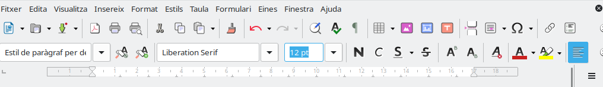
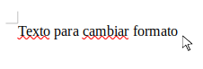
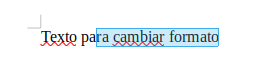
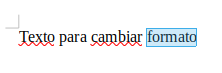
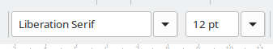
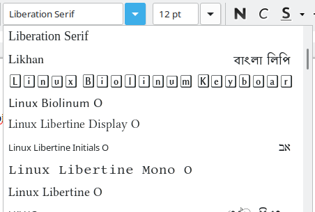
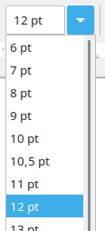
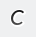

# Formato del texto

El **formato** es el conjunto de cambios que hacemos sobre el **aspecto** de un texto: el tipo de letra, el tamaño, el grosor, la inclinación o el subrayado. Aplicar formato no cambia lo que dice el texto: solo cambia su apariencia.

!!! ejemplo "El mismo texto, con y sin formato"
    Sin formato: Este es el título de mi evento.

    Con formato: **ESTE ES EL TÍTULO DE MI EVENTO**

El objetivo es que el documento sea más **claro**, **ordenado** y **fácil de leer**.

## Seleccionar antes de cambiar

Para cambiar el formato de una palabra o de una frase, primero hay que **seleccionarla**.

1. Colocamos el puntero antes de la primera letra.

    

2. Pulsamos el botón izquierdo del ratón y, sin soltarlo, arrastramos hasta el final.
3. Soltamos el botón. El texto seleccionado aparece marcado con otro color.

    

Para seleccionar **una palabra** rápidamente, hacemos **doble clic** sobre ella.

!!! importante "Sin selección no hay cambio"
    Si no seleccionamos el texto, el formato solo se aplicará a lo que escribamos a continuación.

## El tipo de letra

El tipo de letra también se llama **fuente**. Algunas fuentes habituales son Liberation Sans, Liberation Serif, Arial, Calibri o Verdana.

1. Seleccionamos el texto.

    

2. Abrimos la lista de fuentes de la barra de herramientas.

    

3. Elegimos la fuente.

!!! tip "Consejo"
    Utiliza letras sencillas y fáciles de leer. No mezcles muchas fuentes en el mismo documento: con una o dos es suficiente.

## El tamaño de la letra

El tamaño se mide en **puntos**.

| Elemento { .table-main-column .table-content .table-bg-principal .table-cl-secundario } | Tamaño recomendado { .table-full-container .table-content .table-bg-principal .table-cl-secundario } |
|---|:---:|
| Texto normal { .table-cl-secundario .table-text-bold } | 11 o 12 |
| Datos importantes { .table-cl-secundario .table-text-bold } | 12 o 14 |
| Subtítulos { .table-cl-secundario .table-text-bold } | 14 o 16 |
| Títulos { .table-cl-secundario .table-text-bold } | 18, 20 o 24 |

1. Seleccionamos el texto.
2. Pulsamos sobre el cuadro del tamaño.

    

3. Elegimos o escribimos el número y pulsamos `Intro`.

## Negrita, cursiva y subrayado

| Formato { .table-main-column .table-content .table-bg-principal .table-cl-secundario } | Aspecto { .table-content .table-bg-principal .table-cl-secundario } | Atajo { .table-content .table-bg-principal .table-cl-secundario } | Lo usamos para… { .table-full-container .table-content .table-bg-principal .table-cl-secundario } |
|---|---|:---:|---|
| Negreta { .table-cl-secundario .table-text-bold } | **Letras más gruesas** | `Ctrl + B` | Títulos, palabras importantes y datos que deben verse rápido. |
| Cursiva { .table-cl-secundario .table-text-bold } | *Letras inclinadas* | `Ctrl + I` | Un lema, el título de una obra o dar énfasis a una palabra. |
| Subratllat { .table-cl-secundario .table-text-bold } | <u>Línea debajo</u> | `Ctrl + U` | Una fecha, una norma o una instrucción breve. |

Botones de la barra de herramientas:

| Negreta { .table-main-column .table-content .table-bg-principal .table-cl-secundario } | Cursiva { .table-content .table-bg-principal .table-cl-secundario } | Subratllat { .table-full-container .table-content .table-bg-principal .table-cl-secundario } |
|:---:|:---:|:---:|
|  |  |  |

Para aplicarlos: seleccionamos el texto, pulsamos el botón y comprobamos el resultado. Para **quitarlos**, seleccionamos el texto y volvemos a pulsar el mismo botón.

!!! importante "Destaca poco para que destaque"
    Si todo el texto está en negrita, nada destaca. La cursiva y el subrayado funcionan mejor en palabras o frases cortas.

## Combinar formatos

Un texto puede tener varios formatos a la vez: ***<u>PREPARA TU MOTO Y DISFRUTA DE LA CARRERA</u>*** combina tamaño 14, negrita, cursiva y subrayado. Combinaremos formatos solo para algo especialmente importante.

## Activar el formato antes de escribir

También podemos activar un formato antes de escribir:

1. Pulsamos el botón de negrita.
2. Escribimos la palabra.
3. Volvemos a pulsar el botón para desactivarla.

Si olvidamos desactivarlo, todo lo que escribamos después seguirá en negrita.

## Corregir un formato

- **Volver a pulsar el botón**: seleccionamos el texto y pulsamos otra vez negrita, cursiva o subrayado.
- **Desfés** (`Ctrl + Z`): anula el último cambio, por ejemplo un tamaño equivocado.

## Errores habituales

| Error { .table-main-column .table-content .table-bg-principal .table-cl-secundario } | ¿Qué pasa? { .table-full-container .table-content .table-bg-principal .table-cl-secundario } |
|---|---|
| No seleccionar el texto { .table-cl-secundario .table-text-bold } | El formato no cambia el texto que ya estaba escrito. |
| Dejar activada la negrita { .table-cl-secundario .table-text-bold } | Todo lo que escribimos sigue en negrita. |
| Tamaño demasiado grande { .table-cl-secundario .table-text-bold } | El texto ocupa mucho y el documento cuesta de leer. |
| Demasiados formatos { .table-cl-secundario .table-text-bold } | El documento parece desordenado. |
| No comprobar el resultado { .table-cl-secundario .table-text-bold } | No vemos si hemos cambiado el texto correcto. |

## Un documento claro

- Una o dos fuentes.
- Texto normal en tamaño 11 o 12; títulos más grandes.
- Negrita para lo importante; cursiva y subrayado en fragmentos cortos.
- El mismo formato para los elementos que cumplen la misma función.

> **Seleccionar → Elegir fuente y tamaño → Negrita, cursiva o subrayado → Comprobar → Corregir**

## Comprueba que lo has entendido

1. ¿Qué hay que hacer siempre antes de cambiar el formato de una frase?
2. ¿Qué tamaño de letra usarías para el título de tu cartel? ¿Y para los párrafos?
3. ¿Para qué usarías la negrita en la invitación de tu evento?
4. Todo lo que escribes sale en negrita. ¿Qué ha pasado y cómo lo arreglas?
