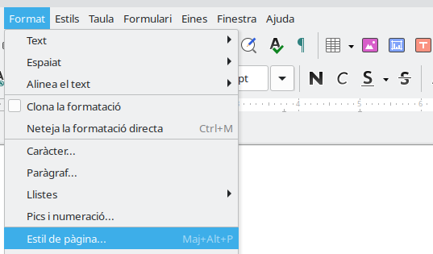
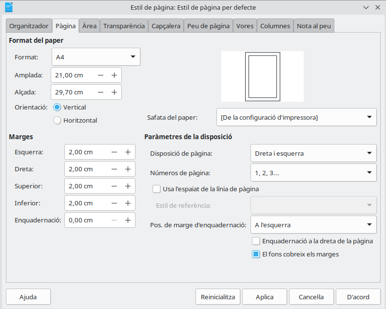

# Configurar la página

Antes de preparar un documento podemos decidir cómo será su página: el **tamaño**, la **orientación** y los **márgenes**. La configuración depende del documento: un cartel y una carta pueden necesitar páginas diferentes.

Todas estas opciones están en el mismo sitio:

1. Abrimos el menú **Format › Estil de pàgina…**

    

2. Vamos a la pestaña **Pàgina**.

    

3. Cambiamos las opciones y pulsamos **D'acord**.

## El tamaño del papel

El tamaño indica las dimensiones de la página al verla o al imprimirla. El más utilizado es el **A4**: **21 cm** de ancho y **29,7 cm** de alto.

En la pestaña **Pàgina**, en el apartado **Format del paper**, elegimos **A4** en la lista **Format**.

!!! nota "Antes de imprimir"
    Comprueba siempre que el tamaño de la página es el correcto.

## La orientación

| Vertical { .table-main-column .table-content .table-bg-principal .table-cl-secundario } | Horitzontal { .table-full-container .table-content .table-bg-principal .table-cl-secundario } |
|---|---|
| La página es más alta que ancha. | La página es más ancha que alta. También se llama **apaisada**. |
| Cartas, informes, fichas, trabajos y portadas. | Carteles, horarios, calendarios y tablas grandes. |

En la pestaña **Pàgina**, en el apartado **Orientació**, elegimos **Vertical** u **Horitzontal**.

## Los márgenes

Los **márgenes** son los espacios en blanco entre el contenido y los bordes de la página. Hay cuatro: **superior**, **inferior**, **esquerre** (izquierdo) y **dret** (derecho).

Los márgenes evitan que el texto quede pegado al borde y hacen que el documento sea más claro y fácil de imprimir.

En la pestaña **Pàgina**, en el apartado **Marges**, escribimos la medida de cada margen. Por ejemplo, **2 cm** en los cuatro lados.

!!! importante "Los márgenes no se hacen con espacios"
    No usamos espacios ni la tecla `Intro` para separar el texto del borde. Los márgenes se configuran en **Estil de pàgina**.

## ¿Qué configuración elegimos?

| Documento { .table-main-column .table-content .table-bg-principal .table-cl-secundario } | Tamaño { .table-content .table-bg-principal .table-cl-secundario } | Orientación { .table-full-container .table-content .table-bg-principal .table-cl-secundario } |
|---|:---:|:---:|
| Carta o invitación { .table-cl-secundario .table-text-bold } | A4 | Vertical |
| Trabajo de clase { .table-cl-secundario .table-text-bold } | A4 | Vertical |
| Cartel de un evento { .table-cl-secundario .table-text-bold } | A4 | Vertical u horizontal |
| Horario o programa { .table-cl-secundario .table-text-bold } | A4 | Horizontal |

No hay una configuración válida para todos los documentos: seguimos siempre las instrucciones de la actividad.

## Comprueba que lo has entendido

1. ¿Cuánto mide una hoja A4?
2. ¿Qué orientación elegirías para el horario de tu evento? ¿Por qué?
3. ¿Qué son los márgenes? ¿Cuántos tiene una página?
4. ¿En qué menú y en qué pestaña se cambian el tamaño, la orientación y los márgenes?
