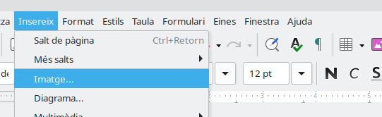
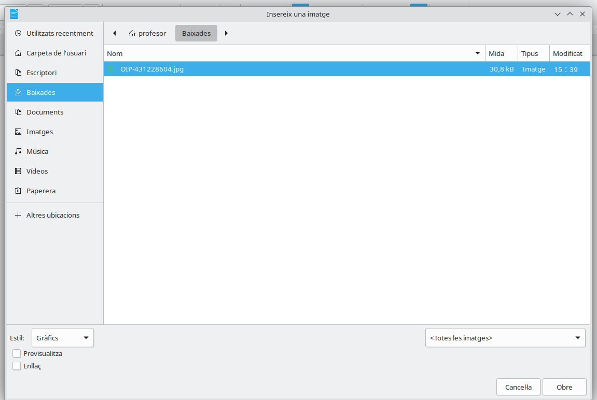
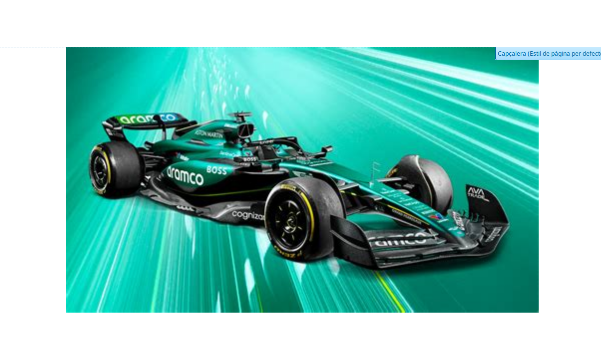

# Insertar imágenes

Las imágenes ayudan a presentar la información de forma más clara y atractiva. Antes de empezar, debemos saber en qué carpeta está guardada la imagen: en nuestro proyecto, en la carpeta `Imagenes`.

## Insertar una imagen

1. Colocamos el cursor donde queremos la imagen.
2. Abrimos el menú **Insereix › Imatge…**

    

3. Buscamos la carpeta donde está guardada.

    

4. Seleccionamos la imagen y pulsamos **Obre**.

La imagen aparecerá dentro del documento.

## Seleccionar una imagen

Para modificar una imagen, primero hacemos **clic** sobre ella. Alrededor aparecen unos pequeños cuadrados: los **controladores de tamaño**.

## Cambiar el tamaño

1. Seleccionamos la imagen.
2. Colocamos el ratón sobre uno de los cuadrados de las **esquinas**.
3. Mantenemos pulsado el botón izquierdo y arrastramos.

!!! importante "Siempre desde una esquina"
    Si arrastramos desde los cuadrados de los lados, la imagen se deforma: queda demasiado ancha o demasiado alta. Si pasa, pulsamos `Ctrl + Z` y lo volvemos a intentar desde una esquina.

Una imagen más grande no siempre queda mejor: debe dejar leer el texto y mantener el documento ordenado.

## Mover y centrar una imagen

Para **moverla**, la seleccionamos, colocamos el ratón en el centro y la arrastramos. Si no se deja mover libremente, hay que cambiar su **ajuste**.

Una forma sencilla de ordenar el documento es dejar la imagen en una línea sola y **centrarla** con el botón **Alineació al centre** de la barra de herramientas.

## El ajuste del texto

El **ajuste** indica cómo se coloca el texto respecto a la imagen. Para cambiarlo, pulsamos con el botón derecho sobre la imagen y elegimos **Ajusta**.

| Ajuste { .table-main-column .table-content .table-bg-principal .table-cl-secundario } | Resultado { .table-full-container .table-content .table-bg-principal .table-cl-secundario } |
|---|---|
| Cap { .table-cl-secundario .table-text-bold } | El texto queda solo por encima y por debajo de la imagen. Es la opción más sencilla. |
| Paral·lel { .table-cl-secundario .table-text-bold } | El texto aparece a los lados de la imagen. Aprovecha mejor el espacio, pero hay que comprobar que se lee bien. |

## Eliminar una imagen

Seleccionamos la imagen y pulsamos `Supr`. Si acabamos de insertarla, también podemos usar `Ctrl + Z`.

## Comprueba que lo has entendido

1. ¿En qué menú está la opción para insertar una imagen?
2. ¿Qué son los controladores de tamaño?
3. ¿Por qué cambiamos el tamaño desde una esquina?
4. Quieres que el texto de tu cartel aparezca al lado de la imagen. ¿Qué opción cambias?
