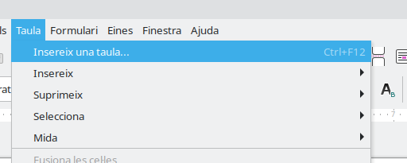
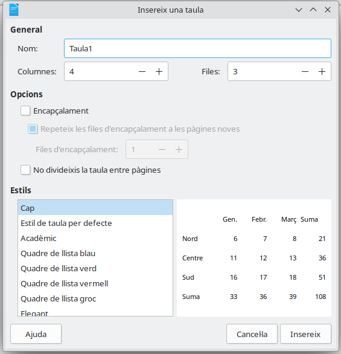
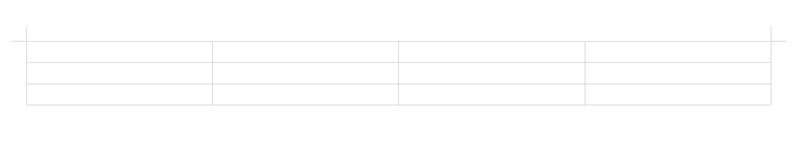
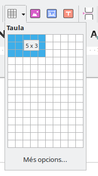

# Crear tablas

Una **tabla** organiza la información en filas y columnas. Podemos usarla para horarios, participantes, clasificaciones, precios o actividades de un evento.

## Partes de una tabla

| Participante { .table-main-column .table-content .table-bg-principal .table-cl-secundario } | Actividad { .table-content .table-bg-principal .table-cl-secundario } | Hora { .table-full-container .table-content .table-bg-principal .table-cl-secundario } |
|---|---|:---:|
| Equipo Azul { .table-cl-secundario .table-text-bold } | Primera prueba | 17:00 |
| Equipo Rojo { .table-cl-secundario .table-text-bold } | Segunda prueba | 17:30 |

- Una **fila** es un conjunto de celdas colocadas en horizontal. En el ejemplo, cada equipo ocupa una fila.
- Una **columna** es un conjunto de celdas colocadas en vertical. El ejemplo tiene tres: Participante, Actividad y Hora.
- Una **celda** es cada uno de los espacios de la tabla. En ella escribimos texto, números o fechas.
- La primera fila suele contener los **encabezados**: explican qué hay en cada columna.

!!! importante "Piensa antes de crear la tabla"
    Antes de insertar una tabla, cuenta cuántas columnas y cuántas filas necesitas. La fila de encabezados también cuenta.

## Insertar una tabla

1. Colocamos el cursor donde queremos la tabla.
2. Abrimos el menú **Taula › Insereix una taula…** (`Ctrl + F12`).

    

3. Indicamos el número de **columnes** y de **files**.

    

4. Pulsamos **Insereix**.

    

También podemos usar el botón **Insereix una taula** de la barra de herramientas.

## Escribir dentro de una tabla

1. Hacemos clic en la celda.
2. Escribimos el contenido.
3. Pulsamos `Tab` para pasar a la celda siguiente (`Mayús + Tab` para volver a la anterior).

Si pulsamos `Tab` en la **última celda**, Writer añade una fila nueva.

!!! importante "Tabulador, no espacios"
    Para pasar de una celda a otra usamos `Tab`. Nunca usamos espacios para separar o colocar los datos.

## Añadir y eliminar filas

| Para… { .table-main-column .table-content .table-bg-principal .table-cl-secundario } | Hacemos clic en una celda de la fila y… { .table-full-container .table-content .table-bg-principal .table-cl-secundario } |
|---|---|
| Añadir una fila { .table-cl-secundario .table-text-bold } | **Taula › Insereix › Files davall** (o **Files damunt**). |
| Eliminar una fila { .table-cl-secundario .table-text-bold } | **Taula › Suprimeix › Files**. |

Antes de eliminar una fila comprobamos que es la correcta. Si nos equivocamos, `Ctrl + Z`.

## Cambiar el ancho de una columna

1. Colocamos el ratón sobre la línea que separa dos columnas.
2. Esperamos a que cambie la forma del puntero.
3. Arrastramos la línea con el botón izquierdo pulsado.

Cada columna debe tener espacio suficiente para leer su contenido.

## Formato básico de la tabla

El texto de una tabla se cambia igual que cualquier otro texto: negrita, cursiva, tamaño o alineación. Normalmente la **fila de encabezados** va:

- en **negrita**;
- **centrada** (botón **Alineació al centre**);
- con un **color de fondo** diferente.

## Errores que debemos evitar

- Crear filas o columnas de más.
- Separar la información con espacios.
- Escribir un dato en la celda equivocada.
- Dejar columnas tan estrechas que el texto no se lee.
- Eliminar una fila sin comprobar cuál era.

## Comprueba que lo has entendido

1. El horario de tu evento tiene 4 actividades y 3 datos de cada una (actividad, lugar y hora). ¿Cuántas filas y columnas necesitas?
2. ¿Qué tecla usamos para pasar a la celda siguiente?
3. ¿Cómo añades una fila al final de la tabla de la forma más rápida?
4. ¿Qué formato suele llevar la fila de encabezados?
