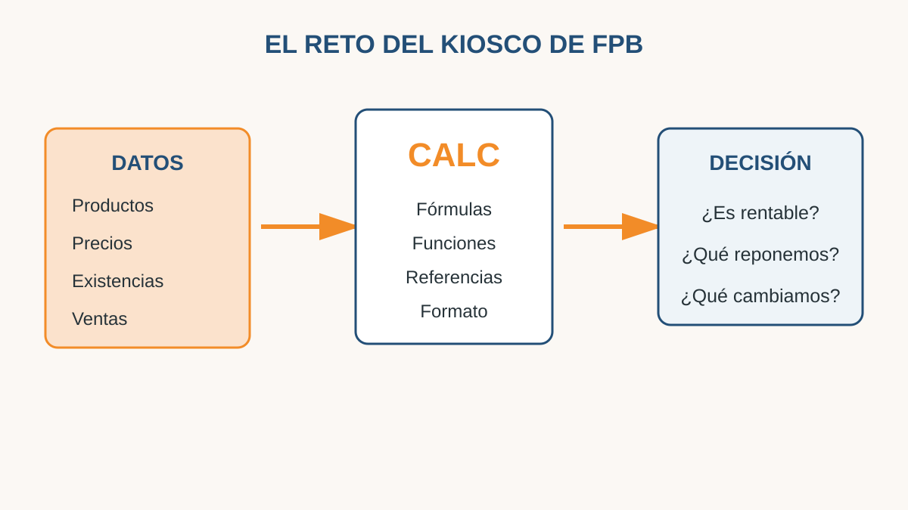

### 1.1. Identificación de la unidad

| Cabecera { .table-oculta .table-full-container .table-content } | Cabecera |
|---|---|
| **Título** { .table-main-column .table-bg-principal .table-cl-secundario } | UP04 · Primeros pasos con Calc |
| **Duración** { .table-main-column .table-bg-principal .table-cl-secundario } | 24 horas |
| **Resultado** { .table-main-column .table-bg-principal .table-cl-secundario } | RA04 |
| **Criterios** { .table-main-column .table-bg-principal .table-cl-secundario } | CE04-a · CE04-b · CE04-e · CE04-f |

!!! salto-pagina-pdf ""

### 1.2. Resultado de aprendizaje

| RA04 { .table-full-container .table-content .table-bg-principal .table-cl-secundario } |
|---|
| Elabora documentos utilizando las aplicaciones básicas de hojas de cálculo. |

### 1.3. Mapa de criterios de evaluación

| CE { .table-main-column .table-content .table-bg-principal .table-cl-secundario } | Descripción { .table-full-container .table-content .table-bg-principal .table-cl-secundario } |
|---|---|
| CE04-a { .table-cl-secundario .table-text-bold } | Utilización de los diversos tipos de datos y referencias para celdas, rangos, hojas y libros. |
| CE04-b { .table-cl-secundario .table-text-bold } | Aplicación de fórmulas y funciones básicas. |
| CE04-e { .table-cl-secundario .table-text-bold } | Utilización de aplicaciones y periféricos para introducir textos, números, códigos e imágenes. |
| CE04-f { .table-cl-secundario .table-text-bold } | Aplicación de las reglas de ergonomía y salud en el desarrollo de las actividades. |

!!! salto-pagina-pdf ""

### 1.4. El reto de la unidad: el kiosco de FPB

Una hoja de cálculo nos permite organizar datos y realizar cálculos. En esta unidad aprenderemos a utilizar **LibreOffice Calc** mientras resolvemos un reto común:

> **¿Podemos abrir un kiosco durante una jornada del centro y obtener beneficios sin quedarnos sin productos?**

Durante la unidad construiremos un único archivo llamado `Kiosco_FPB_Nombre.ods`. El documento tendrá varias hojas:

| Hoja { .table-main-column .table-content .table-bg-principal .table-cl-secundario } | ¿Para qué servirá? { .table-full-container .table-content .table-bg-principal .table-cl-secundario } |
|---|---|
| **Productos** { .table-cl-secundario .table-text-bold } | Guardar el catálogo, los precios y las existencias. |
| **Compras** { .table-cl-secundario .table-text-bold } | Calcular cuánto cuesta comprar los productos. |
| **Ventas** { .table-cl-secundario .table-text-bold } | Registrar las unidades vendidas cada día. |
| **Resumen** { .table-cl-secundario .table-text-bold } | Calcular ingresos, gastos y beneficios. |

Al finalizar podremos responder, utilizando datos, qué productos se venden mejor, cuáles producen más beneficio y qué deberíamos volver a comprar.

!!! nota "Continuará en la UP05"
    En la siguiente unidad ampliaremos el archivo del kiosco con listas ordenadas y filtradas y con gráficos.

!!! salto-pagina-pdf ""
