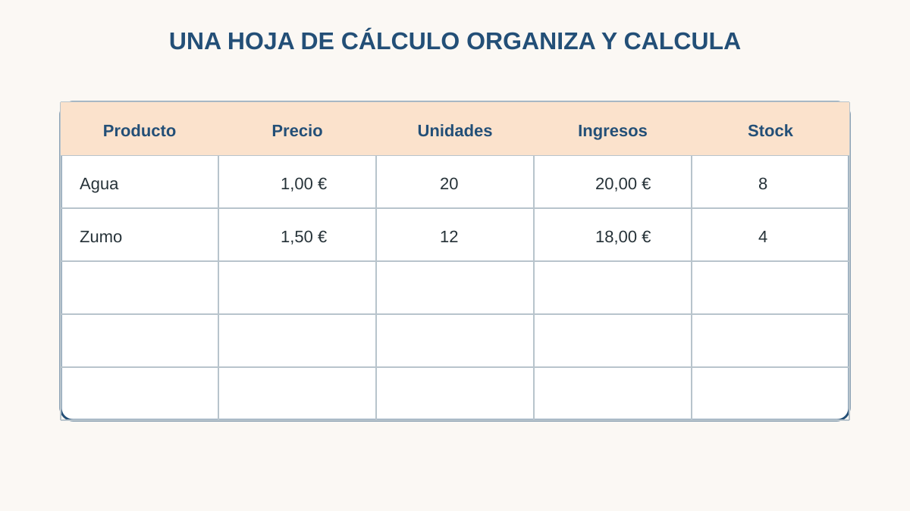

# ¿Qué es una hoja de cálculo?

Una **hoja de cálculo** es una aplicación que organiza la información en una tabla formada por filas y columnas. En sus celdas podemos introducir textos, números y fórmulas.

Las hojas de cálculo se utilizan, por ejemplo, para:

- elaborar presupuestos y facturas;
- controlar productos y existencias;
- registrar ventas o gastos;
- calcular notas o resultados;
- ordenar y filtrar listas;
- crear gráficos.

LibreOffice Calc forma parte de la suite ofimática LibreOffice. Es software libre y puede abrir documentos creados con otras aplicaciones, como Microsoft Excel.

!!! ejemplo "En el kiosco"
    Utilizaremos Calc para almacenar los productos, calcular el dinero recaudado y comprobar si el kiosco obtiene beneficios.

## El archivo y las hojas

El archivo completo recibe el nombre de **libro de cálculo** o **documento de hoja de cálculo**. Dentro del archivo puede haber varias hojas.

Podemos comparar su estructura con una libreta:

- el archivo `.ods` sería la libreta completa;
- cada pestaña inferior sería una hoja de la libreta;
- las celdas serían los pequeños espacios donde escribimos los datos.

## Comprueba que lo has entendido

1. ¿Para qué utilizarías una hoja de cálculo en una tienda?
2. ¿Puede un archivo de Calc contener varias hojas?
3. Indica un dato de tipo texto y otro de tipo numérico que aparecerán en el kiosco.
