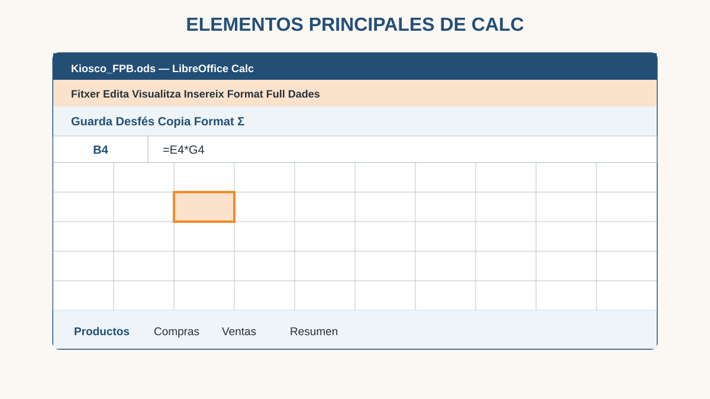

# Primeros pasos con LibreOffice Calc

Al abrir Calc encontramos varios elementos importantes:

| Elemento { .table-main-column .table-content .table-bg-principal .table-cl-secundario } | Función { .table-full-container .table-content .table-bg-principal .table-cl-secundario } |
|---|---|
| **Barra de título** (*Barra de títol*) { .table-cl-secundario .table-text-bold } | Muestra el nombre del archivo. |
| **Barra de menús** (*Barra de menús*) { .table-cl-secundario .table-text-bold } | Contiene los menús **Fitxer**, **Edita**, **Visualitza**, **Insereix**, **Format**, **Estils**, **Full**, **Dades**, **Eines**, **Finestra** y **Ajuda**. |
| **Barras de herramientas** (*Barres d'eines*) { .table-cl-secundario .table-text-bold } | Incluyen botones para guardar, copiar, aplicar formatos o realizar otras acciones. |
| **Cuadro de nombres** (*Quadre de noms*) { .table-cl-secundario .table-text-bold } | Muestra la referencia de la celda activa, por ejemplo `B4`. |
| **Barra de fórmulas** (*Barra de fórmules*) { .table-cl-secundario .table-text-bold } | Permite ver y modificar el contenido de la celda activa. |
| **Área de trabajo** { .table-cl-secundario .table-text-bold } | Cuadrícula en la que introducimos los datos. |
| **Pestañas de hojas** (*Pestanyes dels fulls*) { .table-cl-secundario .table-text-bold } | Permiten cambiar de hoja, crear otras nuevas y cambiarles el nombre. |
| **Barra de estado** (*Barra d'estat*) { .table-cl-secundario .table-text-bold } | Muestra información del documento y permite modificar el zoom. |

!!! importante
    Calc no utiliza la misma cinta de opciones que Excel. Las herramientas se encuentran principalmente en la **barra de menús**, las **barras de herramientas** y la **barra lateral**.

!!! nota "Calc en valenciano"
    En los ordenadores del aula, LibreOffice está en **valenciano**. Por eso, en estos apuntes los menús, las opciones y las funciones aparecen tal como los verás en pantalla: **Fitxer** (Archivo), **Edita** (Editar), **Visualitza** (Ver), **Insereix** (Insertar), **Format** (Formato), **Full** (Hoja), **Dades** (Datos) y **Eines** (Herramientas).

## Crear y guardar un archivo

Para crear una hoja nueva podemos abrir LibreOffice Calc o utilizar **Fitxer > Nou > Full de càlcul**.

La primera vez que guardamos el archivo:

1. Seleccionamos **Fitxer > Anomena i guarda**.
2. Elegimos la carpeta.
3. Escribimos un nombre claro.
4. Comprobamos el tipo de archivo.
5. Pulsamos **Guarda**.

El formato propio de Calc es **ODS** (`.ods`). Es el formato que utilizaremos mientras trabajamos.

| Formato { .table-main-column .table-content .table-bg-principal .table-cl-secundario } | Uso recomendado { .table-full-container .table-content .table-bg-principal .table-cl-secundario } |
|---|---|
| `.ods` { .table-cl-secundario .table-text-bold } | Trabajar y conservar todas las funciones de Calc. |
| `.xlsx` { .table-cl-secundario .table-text-bold } | Compartir el archivo con usuarios de Microsoft Excel. |
| `.csv` { .table-cl-secundario .table-text-bold } | Intercambiar datos sencillos. Solo almacena datos de una hoja y puede perder fórmulas y formatos. |
| `.pdf` { .table-cl-secundario .table-text-bold } | Entregar o imprimir el resultado sin que se modifique fácilmente. |

!!! advertencia
    Al guardar como `.xlsx`, Calc puede mostrar un aviso de compatibilidad. Antes de continuar debemos leerlo. Si todavía estamos trabajando, conservaremos una copia en `.ods`.

## Guardar, guardar como y cerrar

- **Fitxer > Guarda** (**Ctrl + S**) actualiza el archivo manteniendo el mismo nombre y ubicación.
- **Fitxer > Anomena i guarda** crea un archivo con otro nombre, ubicación o formato.
- Si cerramos un documento con cambios sin guardar, Calc nos preguntará qué queremos hacer.

Conviene guardar con frecuencia mediante **Ctrl + S**.

## Comprueba que lo has entendido

1. ¿Qué formato utilizaremos para trabajar normalmente en Calc?
2. ¿Qué diferencia existe entre **Guarda** y **Anomena i guarda**?
3. ¿Por qué un archivo CSV no es adecuado para conservar todo nuestro proyecto?
