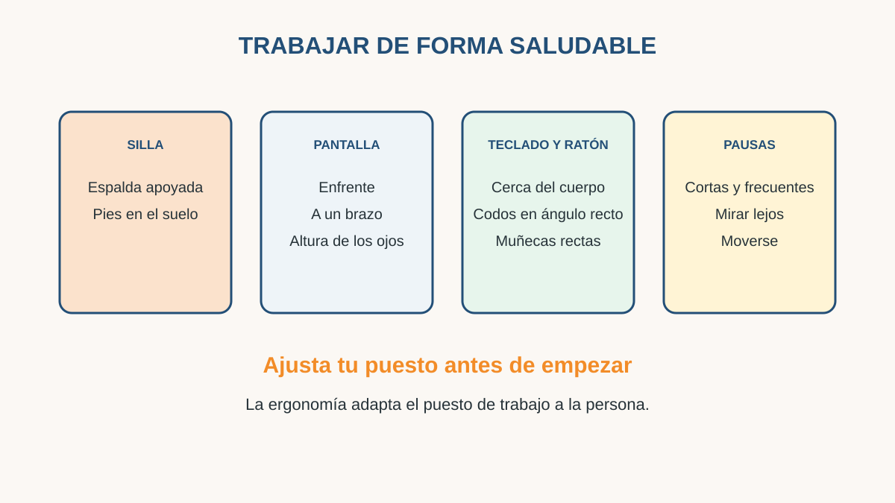

# Trabajar con el ordenador de forma saludable

Para construir el archivo del kiosco pasaremos muchas horas delante del ordenador. Si trabajamos con una mala postura o sin descansar, pueden aparecer dolores de espalda, de cuello, de muñecas o cansancio en los ojos.

La **ergonomía** consiste en adaptar el puesto de trabajo a la persona para que pueda trabajar de forma cómoda, segura y saludable.

!!! importante "Antes de empezar cada sesión"
    Ajusta la silla y la pantalla **antes** de abrir Calc. Cuesta menos de un minuto y evita muchas molestias.

## La postura correcta

| Elemento { .table-main-column .table-content .table-bg-principal .table-cl-secundario } | Recomendación { .table-full-container .table-content .table-bg-principal .table-cl-secundario } |
|---|---|
| **Silla** { .table-cl-secundario .table-text-bold } | Apoya toda la espalda en el respaldo. Los pies deben quedar apoyados en el suelo o en un reposapiés. |
| **Pantalla** { .table-cl-secundario .table-text-bold } | Colócala enfrente, a la distancia de un brazo, con la parte superior a la altura de los ojos o un poco por debajo. |
| **Teclado y ratón** { .table-cl-secundario .table-text-bold } | Colócalos cerca, a la misma altura. Los codos deben formar un ángulo recto y las muñecas deben estar rectas. |
| **Iluminación** { .table-cl-secundario .table-text-bold } | La luz debe llegar de lado. Evita las ventanas detrás de la pantalla o delante de ella, porque producen reflejos y deslumbramientos. |
| **Mesa** { .table-cl-secundario .table-text-bold } | Mantén libre el espacio de trabajo: deja sitio para apoyar los antebrazos y para los documentos que necesites consultar. |

## Las pausas

Aunque la postura sea correcta, permanecer mucho tiempo en la misma posición también cansa.

- Haz **pausas cortas y frecuentes**: es mejor descansar unos minutos cada hora que hacer una sola pausa larga.
- Durante la pausa, **levántate**, camina un poco y mueve el cuello, los hombros y las manos.
- Para descansar la vista, aparta la mirada de la pantalla y **mira algo lejano** durante unos segundos.
- **Parpadea** con frecuencia: delante de la pantalla parpadeamos menos y los ojos se secan.

## Riesgos de trabajar mal

| Riesgo { .table-main-column .table-content .table-bg-principal .table-cl-secundario } | Causa habitual { .table-full-container .table-content .table-bg-principal .table-cl-secundario } |
|---|---|
| **Cansancio visual** { .table-cl-secundario .table-text-bold } | Pantalla demasiado cerca, reflejos, poca luz o no descansar la vista. |
| **Dolor de espalda y cuello** { .table-cl-secundario .table-text-bold } | Sentarse sin apoyar la espalda o con la pantalla demasiado alta o baja. |
| **Molestias en las muñecas** { .table-cl-secundario .table-text-bold } | Doblar las muñecas al escribir o usar el ratón lejos del cuerpo. |
| **Cansancio general** { .table-cl-secundario .table-text-bold } | Trabajar mucho tiempo seguido sin pausas. |

!!! nota "Una norma para el trabajo con pantallas"
    En España, el **Real Decreto 488/1997** establece las condiciones de seguridad y salud para trabajar con equipos que incluyen pantallas de visualización. Las empresas deben adaptar los puestos de trabajo y permitir pausas.

!!! ejemplo "En el kiosco"
    Antes de introducir el catálogo de productos, comprueba tu puesto: espalda apoyada, pies en el suelo, pantalla enfrente y teclado cerca. Cada hora, haz una pausa breve.

## Comprueba que lo has entendido

1. ¿Qué significa la palabra ergonomía?
2. ¿A qué altura debe estar la parte superior de la pantalla?
3. ¿Por qué no conviene trabajar con una ventana detrás de la pantalla?
4. Indica dos cosas que puedes hacer durante una pausa.
