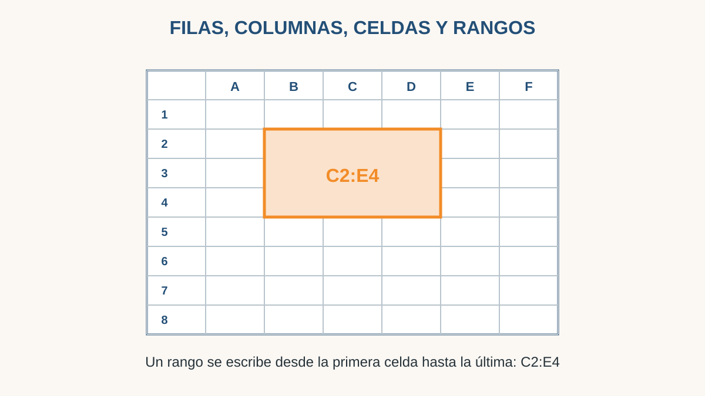

# Filas, columnas, celdas y rangos

El área de trabajo de Calc está formada por:

- **columnas**, identificadas mediante letras: A, B, C…;
- **filas**, identificadas mediante números: 1, 2, 3…;
- **celdas**, formadas por la intersección de una columna y una fila.

Cada celda tiene una referencia. Primero se escribe la letra de la columna y después el número de la fila:

- `A1`: columna A, fila 1;
- `C5`: columna C, fila 5;
- `F12`: columna F, fila 12.

La **celda activa** es la celda seleccionada en ese momento. Su referencia aparece en el cuadro de nombres.

## Rangos de celdas

Un **rango** es un conjunto de celdas. Se representa escribiendo la primera y la última celda separadas por dos puntos:

- `A1:A5`: cinco celdas de la columna A;
- `B2:D2`: celdas desde B2 hasta D2;
- `A1:D10`: tabla comprendida entre A1 y D10.

## Seleccionar elementos

Podemos seleccionar:

- una celda, haciendo clic sobre ella;
- un rango, arrastrando el ratón;
- una fila completa, pulsando su número;
- una columna completa, pulsando su letra;
- celdas no contiguas, manteniendo pulsada la tecla **Ctrl**.

!!! ejemplo "En el kiosco"
    En la hoja **Productos**, la celda `B2` puede contener el texto `Agua`, mientras que el rango `B2:B11` contiene todos los nombres de los productos.

## Trabajar con varias hojas

Las pestañas de la parte inferior permiten:

- crear una hoja nueva;
- cambiar el nombre de una hoja;
- mover o copiar una hoja;
- eliminar una hoja que ya no necesitemos.

Utilizaremos nombres breves y claros: **Productos**, **Compras**, **Ventas** y **Resumen**.

## Comprueba que lo has entendido

1. ¿Qué referencia tiene la celda situada en la columna D y la fila 7?
2. ¿Qué celdas incluye el rango `B2:B6`?
3. ¿Para qué sirve cambiar el nombre de las hojas?
