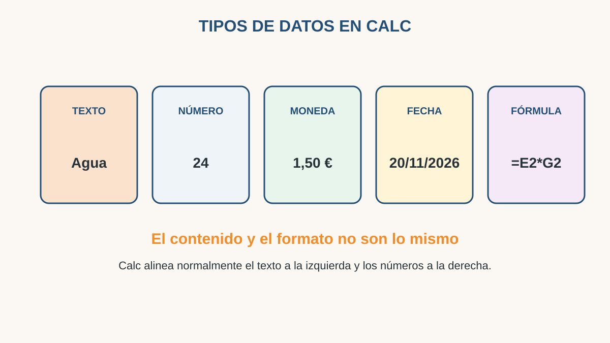

# Introducir, modificar y copiar datos

Una celda puede contener distintos tipos de datos:

| Tipo { .table-main-column .table-content .table-bg-principal .table-cl-secundario } | Ejemplo { .table-full-container .table-content .table-bg-principal .table-cl-secundario } |
|---|---|
| Texto { .table-cl-secundario .table-text-bold } | `Agua` |
| Número { .table-cl-secundario .table-text-bold } | `24` |
| Número decimal { .table-cl-secundario .table-text-bold } | `1,50` |
| Fecha { .table-cl-secundario .table-text-bold } | `20/11/2026` |
| Porcentaje { .table-cl-secundario .table-text-bold } | `10 %` |
| Fórmula { .table-cl-secundario .table-text-bold } | `=D2*F2` |

Para introducir un dato:

1. Seleccionamos una celda.
2. Escribimos el contenido.
3. Pulsamos **Intro**.

Para modificarlo podemos hacer doble clic sobre la celda o editarlo desde la barra de fórmulas. La tecla **Supr** permite borrar el contenido seleccionado.

## Copiar, cortar y pegar

- **Ctrl + C**: copiar.
- **Ctrl + X**: cortar.
- **Ctrl + V**: pegar.
- **Ctrl + Z**: deshacer.
- **Ctrl + Y**: rehacer.

Copiar mantiene el contenido original. Cortar lo mueve a otra posición.

## El controlador de relleno

En la esquina inferior derecha de la celda seleccionada aparece un pequeño cuadrado llamado **controlador de relleno**. Al arrastrarlo podemos:

- copiar un dato o una fórmula;
- continuar una serie de números;
- completar días, meses o fechas.

Por ejemplo, si escribimos `1` y `2`, seleccionamos ambas celdas y arrastramos, Calc puede continuar la serie con `3`, `4`, `5`…

!!! importante
    Después de copiar o rellenar, debemos comprobar el resultado. Arrastrar más rápido no sirve si copiamos un dato incorrecto.

## Ajustar filas y columnas

Podemos cambiar el ancho de una columna o la altura de una fila arrastrando el límite de su encabezado. Si hacemos doble clic sobre ese límite, Calc intenta ajustar el tamaño al contenido.

## Comprueba que lo has entendido

1. ¿Qué diferencia existe entre copiar y cortar?
2. ¿Para qué sirve el controlador de relleno?
3. ¿Qué combinación de teclas permite deshacer una acción incorrecta?
