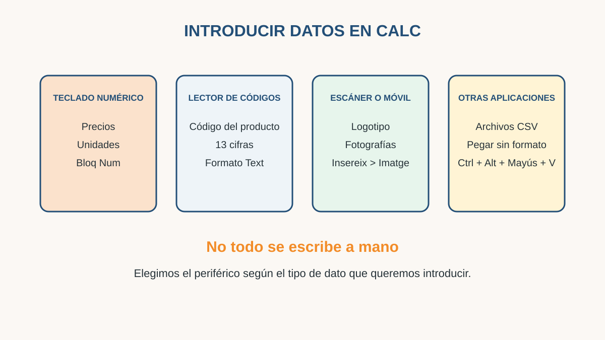

# Introducir datos con periféricos y aplicaciones

Los **periféricos de entrada** son los dispositivos que utilizamos para introducir información en el ordenador. En Calc no solo escribimos con el teclado: también podemos leer códigos, añadir imágenes o aprovechar datos que ya están en otro archivo.

| Periférico o aplicación { .table-main-column .table-content .table-bg-principal .table-cl-secundario } | ¿Para qué lo usamos en Calc? { .table-full-container .table-content .table-bg-principal .table-cl-secundario } |
|---|---|
| **Teclado** { .table-cl-secundario .table-text-bold } | Escribir textos, números y fórmulas. |
| **Teclado numérico** { .table-cl-secundario .table-text-bold } | Introducir muchas cifras de forma rápida, como precios o unidades. |
| **Ratón** { .table-cl-secundario .table-text-bold } | Seleccionar celdas, elegir opciones de los menús y arrastrar el controlador de relleno. |
| **Lector de códigos de barras** { .table-cl-secundario .table-text-bold } | Escribir automáticamente el código de un producto en la celda activa. |
| **Escáner o cámara del móvil** { .table-cl-secundario .table-text-bold } | Obtener imágenes, como un logotipo o la fotografía de un producto. |
| **Otras aplicaciones** { .table-cl-secundario .table-text-bold } | Aprovechar datos de otro archivo, por ejemplo una lista de productos en formato CSV. |

## El teclado numérico

El bloque de teclas de la derecha del teclado permite introducir números con una sola mano.

1. Comprueba que está activada la tecla **Bloq Num**. Normalmente se enciende una luz.
2. Escribe el número.
3. Pulsa **Intro** para pasar a la celda de abajo.

!!! importante
    Comprueba que los decimales aparecen con **coma**, por ejemplo `1,50`. Si Calc muestra el dato alineado a la izquierda, lo está tratando como texto y no podrá utilizarlo en los cálculos.

## Introducir códigos

En el kiosco, cada producto tendrá un **código**. Puede ser un código propio, como `KIO-001`, o el **código de barras** que aparece en el envase.

Un **lector de códigos de barras** funciona como un teclado: cuando lee el código, lo escribe en la celda activa y pulsa **Intro** automáticamente.

Los códigos de barras suelen tener **13 cifras**. Aunque están formados por números, no se utilizan para hacer cálculos. Por eso pueden aparecer dos problemas:

| Problema { .table-main-column .table-content .table-bg-principal .table-cl-secundario } | Solución { .table-full-container .table-content .table-bg-principal .table-cl-secundario } |
|---|---|
| **Desaparece el cero inicial**: `0123` se convierte en `123`. | Escribe un apóstrofo delante (`'0123`) o aplica a la columna el formato **Text** antes de introducir los códigos. |
| **El código se muestra abreviado**, por ejemplo `8,41E+12`. | Ensancha la columna o aplica el formato **Text**. |

## Insertar imágenes

Podemos añadir el logotipo del kiosco o la fotografía de un producto.

1. Selecciona la celda donde quieres colocar la imagen.
2. Abre el menú **Insereix > Imatge**.
3. Busca el archivo y pulsa **Obri**.
4. Ajusta el tamaño arrastrando una esquina mientras mantienes pulsada la tecla **Mayús**, para que no se deforme.

Si la imagen procede del **escáner** o de la **cámara del móvil**, guárdala antes en la carpeta del proyecto con un nombre claro, por ejemplo `logo_kiosco.png`.

## Aprovechar datos de otras aplicaciones

No siempre hace falta escribir los datos desde el principio:

- **Abrir un archivo CSV**: al abrirlo, Calc muestra la ventana **Importació de text** para elegir cómo se separan los datos (coma, punto y coma, tabulación…).
- **Copiar desde otra aplicación**: si copiamos datos de una página web o de un documento, podemos pegarlos como texto sin formato con **Ctrl + Alt + Mayús + V** para evitar colores y tipos de letra extraños.

!!! ejemplo "En el kiosco"
    En la hoja **Productos** añadiremos una columna **Código** con formato **Text** e insertaremos el logotipo del kiosco en la parte superior.

## Comprueba que lo has entendido

1. ¿Qué es un periférico de entrada? Pon dos ejemplos.
2. ¿Qué tecla debe estar activada para utilizar el teclado numérico?
3. ¿Por qué conviene dar formato de texto a una columna de códigos de barras?
4. ¿Cómo evitarías que una imagen se deforme al cambiar su tamaño?
