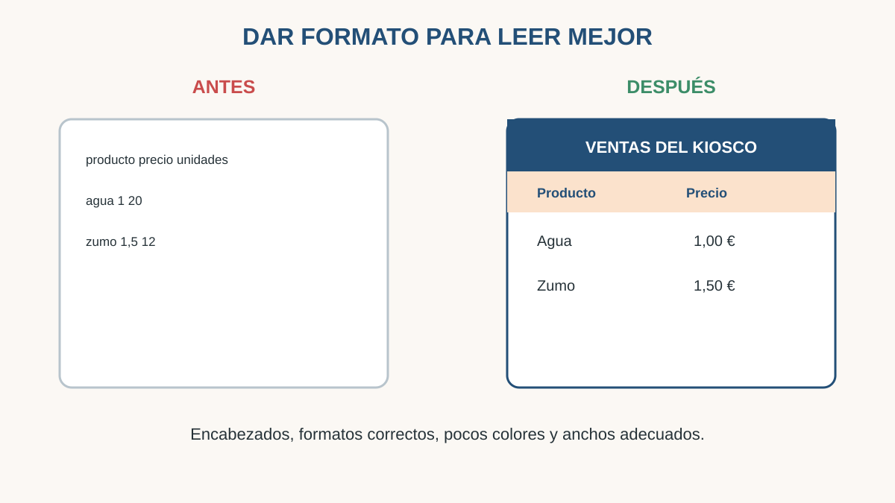

# Formato de datos y celdas

El **contenido** de una celda es el dato que almacena. El **formato** es la forma en la que ese dato se presenta.

El número `1,5` puede mostrarse de distintas maneras:

- `1,5` como número;
- `1,50 €` como moneda;
- `150 %` como porcentaje;
- `31/12/1899 12:00` si se aplica accidentalmente un formato de fecha (Calc cuenta los días desde el 30/12/1899).

Cambiar el formato no modifica necesariamente el valor almacenado, pero sí la forma en que lo vemos.

## Formatos numéricos habituales

| Formato { .table-main-column .table-content .table-bg-principal .table-cl-secundario } | Ejemplo { .table-content .table-bg-principal .table-cl-secundario } | Uso { .table-full-container .table-content .table-bg-principal .table-cl-secundario } |
|---|---|---|
| Número { .table-cl-secundario .table-text-bold } | `24` | Cantidades y unidades. |
| Decimal { .table-cl-secundario .table-text-bold } | `1,50` | Precios o medidas. |
| Moneda { .table-cl-secundario .table-text-bold } | `1,50 €` | Importes económicos. |
| Porcentaje { .table-cl-secundario .table-text-bold } | `10 %` | Impuestos, descuentos o variaciones. |
| Fecha { .table-cl-secundario .table-text-bold } | `20/11/2026` | Días de compra o venta. |

Podemos acceder a más opciones mediante **Format > Cel·les** o con **Ctrl + 1**.

## Mejorar la presentación

En una celda o rango podemos modificar:

- tipo y tamaño de letra;
- negrita, cursiva y color de texto;
- alineación horizontal y vertical;
- ajuste del texto;
- color de fondo;
- bordes;
- formato numérico.

Una tabla debe ser clara antes que llamativa. Usaremos:

- un título visible;
- encabezados destacados;
- formatos numéricos correctos;
- pocos colores;
- columnas con un ancho adecuado;
- bordes sencillos.

!!! advertencia
    Combinar celdas puede ser útil para un título, pero no conviene hacerlo dentro de una lista de datos porque puede dificultar la ordenación y el filtrado.

## Copiar solo el formato

La herramienta **Clona el format** (el pincel de la barra de herramientas) permite copiar el aspecto de una celda sin copiar su contenido. También podemos utilizar el pegado especial para decidir qué elementos queremos pegar.

## Comprueba que lo has entendido

1. ¿Qué formato aplicarías al precio de un bocadillo?
2. ¿Cambiar el color de una celda modifica su valor?
3. ¿Por qué no debemos utilizar demasiados colores?
