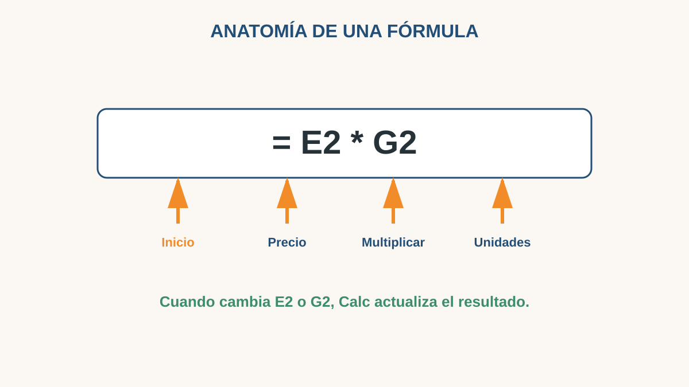

# Fórmulas y operadores



Una **fórmula** es una expresión que realiza un cálculo. En Calc, todas las fórmulas comienzan por el signo igual (`=`).

Ejemplos:

```text
=2+3
=10-4
=6*5
=20/4
```

Los operadores principales son:

| Operación { .table-main-column .table-content .table-bg-principal .table-cl-secundario } | Operador { .table-content .table-bg-principal .table-cl-secundario } | Ejemplo { .table-full-container .table-content .table-bg-principal .table-cl-secundario } |
|---|:---:|---|
| Suma { .table-cl-secundario .table-text-bold } | `+` | `=B2+C2` |
| Resta { .table-cl-secundario .table-text-bold } | `-` | `=F2-G2` |
| Multiplicación { .table-cl-secundario .table-text-bold } | `*` | `=D2*F2` |
| División { .table-cl-secundario .table-text-bold } | `/` | `=I2/G2` |
| Potencia { .table-cl-secundario .table-text-bold } | `^` | `=B2^2` |

## Utilizar referencias

Aunque podemos escribir `=2*10`, normalmente utilizaremos las referencias de las celdas:

```text
=D2*F2
```

Si `D2` contiene el precio y `F2` las unidades, la fórmula calcula el importe. Cuando cambie el precio o la cantidad, el resultado se actualizará automáticamente.

!!! ejemplo "Primeros cálculos del kiosco"
    Si el precio de venta está en `E2` y las unidades vendidas en `G2`, los ingresos se calculan con `=E2*G2`.

## Orden de las operaciones

Calc respeta el orden matemático:

1. paréntesis;
2. potencias;
3. multiplicaciones y divisiones;
4. sumas y restas.

Por eso, estas fórmulas no producen el mismo resultado:

```text
=10+5*2
=(10+5)*2
```

Cuando tengamos dudas, utilizaremos paréntesis.

## Errores frecuentes

- olvidar el signo `=`;
- escribir una coma decimal o un separador incorrecto;
- utilizar una referencia equivocada;
- dividir entre cero;
- borrar una celda que utiliza una fórmula;
- escribir texto en una celda que debería contener un número.

Cuando el resultado no sea correcto, seleccionaremos la celda y revisaremos la fórmula en la barra de fórmulas.

## Comprueba que lo has entendido

1. ¿Con qué signo comienza una fórmula?
2. Escribe la fórmula que multiplica el contenido de `C2` por el de `D2`.
3. ¿Por qué es mejor utilizar referencias que escribir directamente los números en la fórmula?
