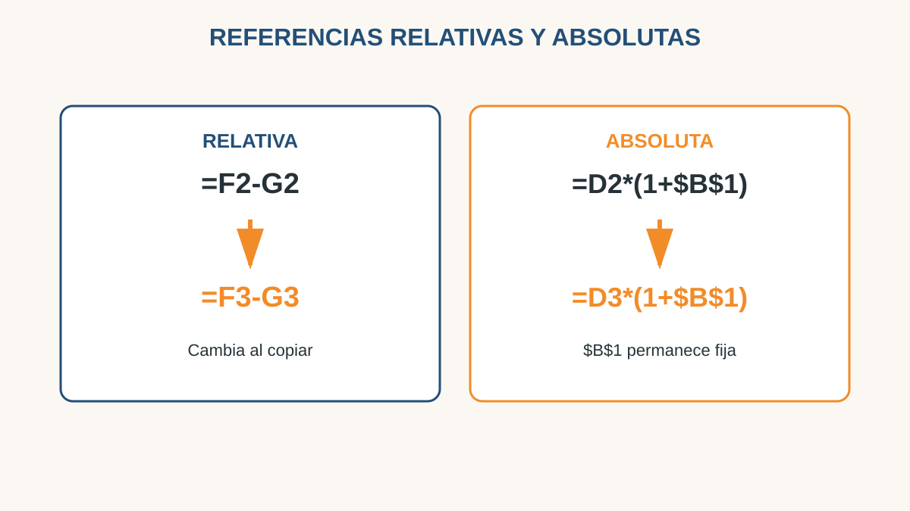

# Copiar fórmulas y utilizar referencias



Cuando copiamos una fórmula, Calc puede modificar sus referencias según la nueva posición. Para controlar este comportamiento existen referencias relativas y absolutas.

## Referencias relativas

Una referencia como `A1` es **relativa**. Cambia cuando copiamos la fórmula.

Si en `H2` tenemos:

```text
=F2-G2
```

y arrastramos la fórmula hasta `H3`, Calc la transforma en:

```text
=F3-G3
```

Esto permite calcular el stock final de todos los productos sin escribir la fórmula cada vez.

## Referencias absolutas

Una referencia como `$B$1` es **absoluta**. No cambia al copiar la fórmula. El símbolo `$` fija la columna y la fila.

Supongamos que `B1` contiene un IVA de `10 %`. Para calcular un precio con IVA podemos utilizar:

```text
=D2*(1+$B$1)
```

Al copiar la fórmula hacia abajo, `D2` cambiará a `D3`, `D4`…, pero `$B$1` seguirá apuntando al porcentaje común.

!!! importante "Un atajo útil"
    Mientras escribes la fórmula, coloca el cursor sobre una referencia y pulsa **Mayús + F4**: Calc va cambiando entre `B1`, `$B$1`, `B$1` y `$B1`. (En Excel es F4; en LibreOffice Calc es **Mayús + F4**.)

!!! nota
    Para practicar utilizaremos un único porcentaje en el ejercicio, aunque en una situación real distintos productos pueden tener impuestos diferentes.

## Referencias mixtas

Las referencias mixtas fijan solamente una parte:

- `$A1`: columna fija y fila variable;
- `A$1`: columna variable y fila fija.

Las utilizaremos únicamente en ejercicios de ampliación.

## ¿Cómo elegir la referencia correcta?

Antes de copiar una fórmula debemos preguntarnos:

> ¿Esta referencia debe cambiar para cada producto o debe apuntar siempre a la misma celda?

- Si debe cambiar, utilizaremos una referencia relativa.
- Si debe mantenerse, utilizaremos una referencia absoluta.

## Comprueba que lo has entendido

1. ¿En qué se convierte `=B2*C2` al copiarla una fila hacia abajo?
2. ¿Qué parte puede cambiar en la referencia `$A1`?
3. ¿Por qué utilizaríamos `$B$1` para el porcentaje de IVA?
