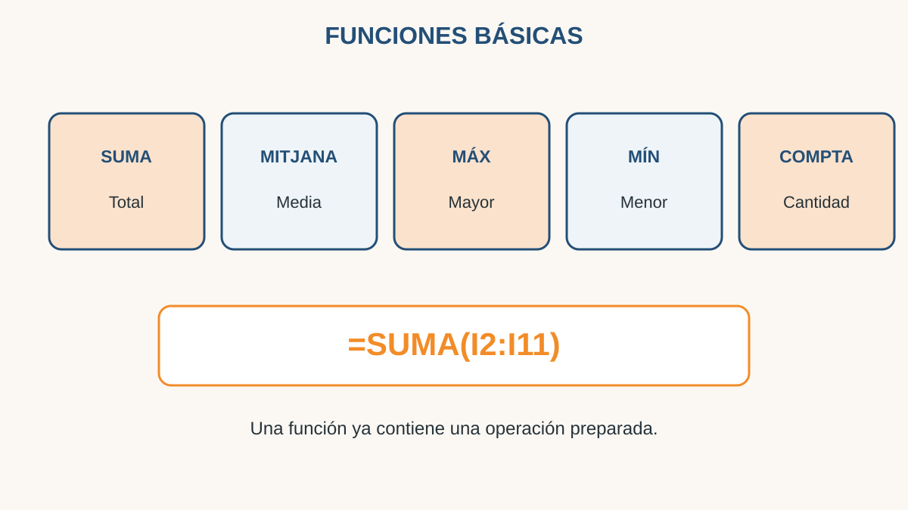

# Funciones básicas



Una **función** es una fórmula ya preparada que realiza una operación. Su estructura habitual es:

```text
=NOMBRE(argumentos)
```

Los dos puntos representan un rango y el punto y coma separa argumentos diferentes.

## Funciones principales

| Función { .table-main-column .table-content .table-bg-principal .table-cl-secundario } | ¿Qué hace? { .table-content .table-bg-principal .table-cl-secundario } | Ejemplo { .table-full-container .table-content .table-bg-principal .table-cl-secundario } |
|---|---|---|
| `SUMA` { .table-cl-secundario .table-text-bold } | Suma los valores. | `=SUMA(G2:G11)` |
| `MITJANA` { .table-cl-secundario .table-text-bold } | Calcula la media. | `=MITJANA(G2:G11)` |
| `MÁX` { .table-cl-secundario .table-text-bold } | Devuelve el valor mayor. | `=MÁX(G2:G11)` |
| `MÍN` { .table-cl-secundario .table-text-bold } | Devuelve el valor menor. | `=MÍN(G2:G11)` |
| `COMPTA` { .table-cl-secundario .table-text-bold } | Cuenta las celdas que contienen números. | `=COMPTA(G2:G11)` |

!!! ejemplo "Resumen del kiosco"
    `=SUMA(I2:I11)` calcula los ingresos totales. `=MÁX(G2:G11)` indica la mayor cantidad vendida de un producto.

## La función SI

La función `SI` permite obtener un resultado u otro según se cumpla una condición:

```text
=SI(H2<5;"RECOMPRAR";"SUFICIENTE")
```

La función comprueba si el stock final de `H2` es inferior a 5:

- si se cumple, muestra `RECOMPRAR`;
- si no se cumple, muestra `SUFICIENTE`.

La trabajaremos de forma guiada. Lo importante es entender sus tres partes:

```text
=SI(condición;resultado si se cumple;resultado si no se cumple)
```

## Insertar una función

Podemos escribirla directamente o utilizar el **Assistent de funcions** (botón *fx* de la barra de fórmulas). El asistente ayuda a seleccionar la función y completar sus argumentos.

Después de introducirla debemos comprobar:

- que el nombre sea correcto;
- que el rango incluya todas las celdas necesarias;
- que los paréntesis estén cerrados;
- que los argumentos estén separados correctamente.

## Comprueba que lo has entendido

1. ¿Qué función utilizarías para calcular los ingresos totales?
2. ¿Qué diferencia existe entre `SUMA` y `MITJANA`?
3. ¿Qué mostrará `=SI(A1<5;"POCO";"BIEN")` si A1 contiene 3?
