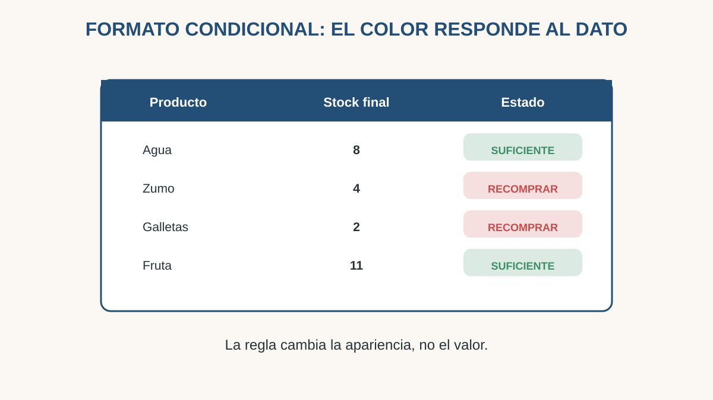

# Dar formato para comprender los datos

El formato también puede ayudarnos a interpretar la información.

## Formato condicional

El **formato condicional** cambia automáticamente el aspecto de las celdas cuando cumplen una regla.

En Calc se configura desde **Format > Condicional**. Podemos utilizarlo para:

- destacar existencias bajas;
- mostrar ventas altas con otro color;
- representar valores mediante barras de datos;
- aplicar una escala de colores.

!!! ejemplo "Alerta de existencias"
    Podemos aplicar un fondo rojo a las celdas de stock final que sean inferiores a 5. Si el valor cambia, el color se actualiza automáticamente.

El formato condicional no cambia el valor de la celda. Solo modifica su apariencia.

## Estilos de celda

Un **estilo** reúne varias características de formato. Permite mantener un aspecto coherente en todo el documento. Podemos utilizar estilos para títulos, encabezados, resultados y avisos.

Para una actividad sencilla también podemos aplicar directamente negrita, fondo, bordes y alineación. Sin embargo, los estilos resultan útiles cuando el documento crece.

## Reglas de presentación

Antes de considerar terminada una hoja comprobaremos:

- que todas las columnas tengan encabezado;
- que los precios aparezcan como moneda;
- que las cantidades no tengan decimales innecesarios;
- que no haya textos cortados;
- que los colores tengan un significado;
- que los totales estén destacados;
- que el documento se pueda leer sin explicaciones adicionales.

## Comprueba que lo has entendido

1. ¿El formato condicional modifica el dato almacenado?
2. ¿Qué regla podríamos utilizar para detectar productos casi agotados?
3. ¿Por qué los colores deben tener un significado?
