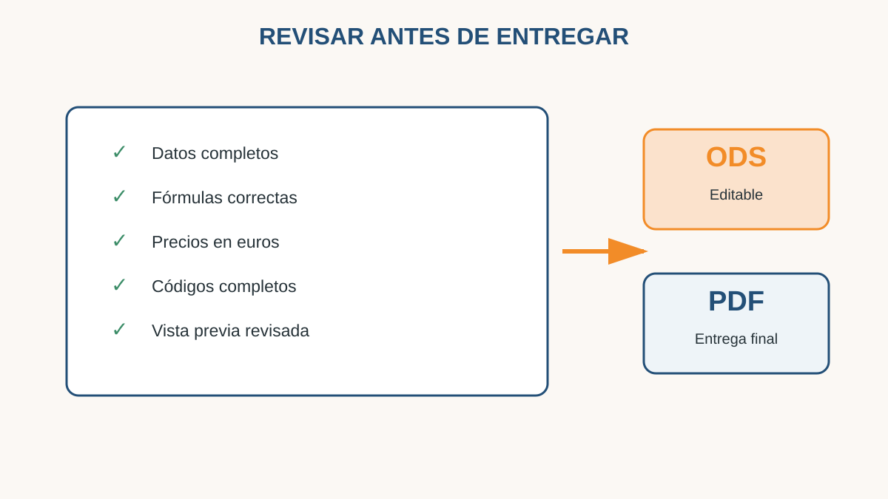

# Revisar, imprimir y exportar

Antes de entregar una hoja de cálculo debemos comprobar tanto los datos como su presentación.

## Revisión de cálculos

Comprobaremos:

- que las fórmulas comiencen por `=`;
- que los rangos sean correctos;
- que no falten productos;
- que los precios tengan formato de moneda;
- que las fórmulas copiadas utilicen las referencias adecuadas;
- que los totales coincidan con una comprobación sencilla;
- que no aparezcan mensajes de error.

Una cifra muy grande o negativa puede ser correcta, pero también puede indicar que hemos utilizado una celda equivocada.

## Preparar la impresión

En la previsualización de impresión (**Ctrl + Mayús + O**) comprobaremos:

- orientación vertical u horizontal;
- tamaño y márgenes de la página;
- escala de impresión;
- filas y columnas incluidas;
- posibles páginas vacías;
- títulos cortados.

No debemos imprimir hasta revisar la previsualización.

## Exportar a PDF

El PDF resulta útil para entregar o imprimir el resultado final. Podemos utilizar **Fitxer > Exporta com a > Exporta com a PDF**.

Guardaremos dos archivos:

- `Kiosco_FPB_Nombre.ods`: documento editable;
- `Kiosco_FPB_Nombre.pdf`: versión final para consultar o imprimir.

## Lista de control final

- [ ] El archivo tiene un nombre correcto.
- [ ] Las hojas tienen nombres claros.
- [ ] Los datos están completos.
- [ ] Los precios aparecen como moneda.
- [ ] Las fórmulas ofrecen resultados correctos.
- [ ] Los totales utilizan funciones.
- [ ] Se distinguen las referencias relativas y absolutas.
- [ ] Los códigos de los productos se ven completos.
- [ ] La hoja **Productos** incluye el logotipo del kiosco.
- [ ] He trabajado con una postura correcta y he hecho pausas.
- [ ] El documento se ha guardado en ODS y exportado a PDF.
