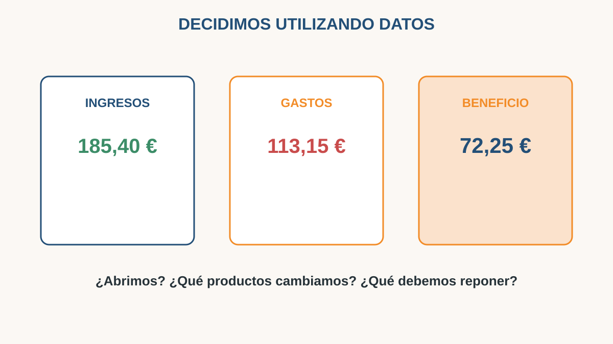

# Conclusión del proyecto

Al finalizar el archivo analizaremos los resultados para tomar una decisión:

1. ¿Cuánto dinero se ha gastado en productos?
2. ¿Cuánto dinero se ha ingresado?
3. ¿Cuál es el beneficio total?
4. ¿Qué producto se ha vendido más?
5. ¿Qué producto produce más beneficio?
6. ¿Qué productos deben volver a comprarse?
7. ¿Hay algún producto que no compensa vender?

La conclusión no debe basarse en gustos personales, sino en los datos de la hoja de cálculo.

Podremos elegir una de estas decisiones y justificarla:

- **Abrimos el kiosco con todos los productos.**
- **Abrimos el kiosco, pero cambiamos algunos productos o cantidades.**
- **No abrimos el kiosco porque los datos indican que no resulta rentable.**

> Una hoja de cálculo no toma las decisiones por nosotros, pero nos proporciona información para decidir mejor.
