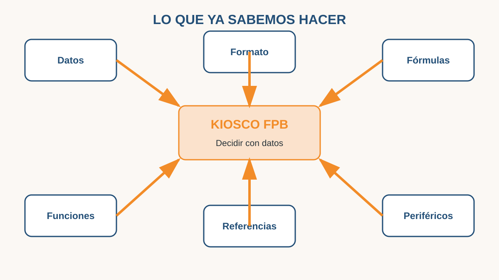

# Resumen y preguntas finales

| Concepto { .table-main-column .table-content .table-bg-principal .table-cl-secundario } | Significado { .table-full-container .table-content .table-bg-principal .table-cl-secundario } |
|---|---|
| Libro o documento { .table-cl-secundario .table-text-bold } | Archivo completo de Calc. |
| Hoja { .table-cl-secundario .table-text-bold } | Cada una de las pestañas del documento. |
| Celda { .table-cl-secundario .table-text-bold } | Intersección entre una columna y una fila. |
| Rango { .table-cl-secundario .table-text-bold } | Conjunto de celdas. |
| Fórmula { .table-cl-secundario .table-text-bold } | Expresión de cálculo que comienza por `=`. |
| Función { .table-cl-secundario .table-text-bold } | Fórmula preparada, como `SUMA` o `MITJANA`. |
| Referencia relativa { .table-cl-secundario .table-text-bold } | Cambia al copiar la fórmula. |
| Referencia absoluta { .table-cl-secundario .table-text-bold } | Se mantiene fija mediante `$`. |
| Periférico de entrada { .table-cl-secundario .table-text-bold } | Dispositivo para introducir datos, como el teclado numérico o el lector de códigos de barras. |
| Ergonomía { .table-cl-secundario .table-text-bold } | Adaptación del puesto de trabajo a la persona para trabajar de forma cómoda y saludable. |

## Preguntas finales

1. ¿Qué diferencia hay entre una celda y un rango?
2. ¿Qué símbolo debe aparecer al principio de una fórmula?
3. ¿Qué ventaja tiene utilizar referencias en las fórmulas?
4. ¿Cuándo necesitamos una referencia absoluta?
5. ¿Qué función calcula la media de un rango?
6. ¿Cómo evitarías que Calc elimine el cero inicial de un código?
7. Indica dos recomendaciones para trabajar con el ordenador sin dañar tu salud.
8. ¿Por qué debemos conservar el archivo ODS aunque exportemos un PDF?

## Fuentes de consulta

- [Ayuda de LibreOffice Calc](https://help.libreoffice.org/latest/es/text/scalc/guide/main.html)
- [Documentación oficial de LibreOffice Calc](https://documentation.libreoffice.org/es/documentacion-en-espanol/calc/)
